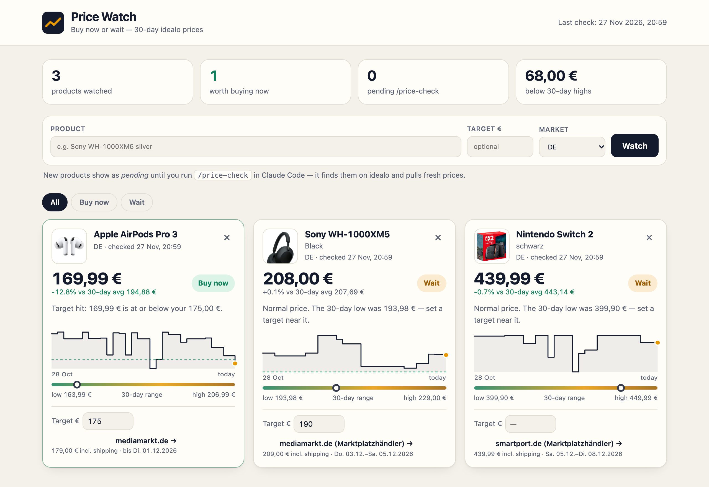
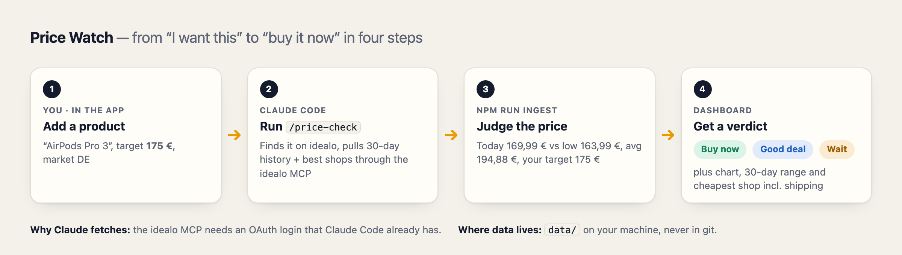
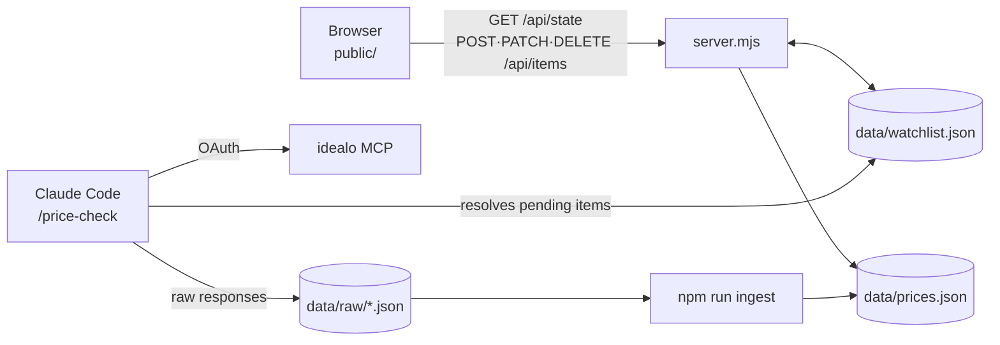
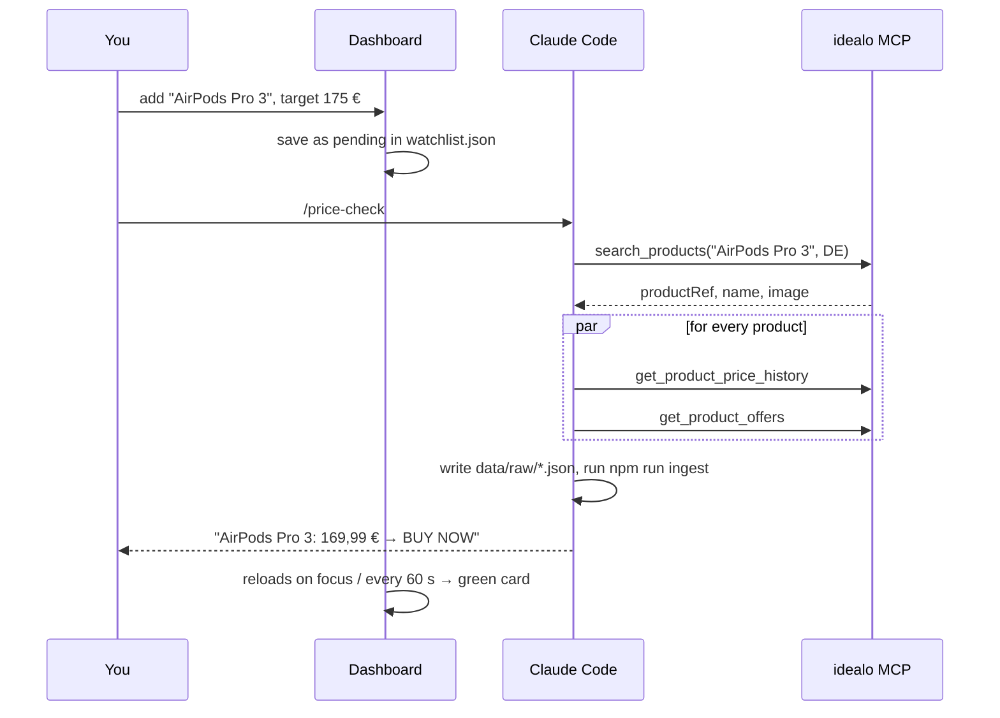

<div align="center">

# 📉 Price Watch

### Know whether to buy now or wait.

**Watch products on idealo, set a target price, and get a clear verdict for each: *Buy now*, *Good deal* or *Wait*.<br/>
Claude Code fetches 30 days of prices through the idealo MCP. A small local app turns them into a decision.**


Runs locally on your machine · your watchlist never leaves it

</div>

> **Try it in one minute:** `npm run seed && npm start`, then open <http://127.0.0.1:4321>.
> You'll see three real products with idealo prices from 27 Nov 2026. **AirPods Pro 3 shows *Buy now***: 169,99 € is below its 175 € target.
> For live prices, open Claude Code in this folder and run **`/price-check`**.

<p align="center">
  <picture>
    <source media="(prefers-color-scheme: dark)" srcset="docs/img/dashboard-dark.png">
    
  </picture>
</p>

---

## The idea

idealo already shows you where a product is cheapest **today**. It doesn't tell you whether today is a good day to buy. Prices around Black Friday jump: the AirPods Pro 3 swung between 163,99 € and 206,99 € in one month. To judge a price you need the last few weeks of prices, your own limit, and the cheapest shop including shipping. That means three idealo pages per product, every day.

Price Watch keeps the list for you, and Claude does the checking.

| Without Price Watch | With Price Watch |
|---|---|
| Open idealo for each product, every day | One `/price-check` refreshes the whole list |
| Guess whether 208 € is a good price | *"Normal price. The 30-day low was 193,98 €."* |
| Remember your target price | Target is stored; the card turns green when the price reaches it |
| Compare shops' shipping by hand | Cheapest offer **including shipping** on every card |
| Bookmarks scattered across six country sites | One list across DE, AT, FR, IT, ES, UK |

## How it works

<p align="center"></p>

1. **You** add a product in the app, e.g. *"AirPods Pro 3", target 175 €, market DE*. It shows as *pending*.
2. **Claude Code** runs `/price-check`. It finds each pending product with `search_products`, then loads its `get_product_price_history` and `get_product_offers` for every item. All the calls go out in one batch.
3. **`npm run ingest`** turns the raw idealo responses ("1.234,56 €" strings, offer pages) into numbers and prints one verdict per product.
4. **The dashboard** reloads by itself: a verdict, a 30-day step chart with your target line, where today's price sits between the 30-day low and high, and the cheapest shop.

### The verdicts

The rules are checked in order; the first that matches wins. See `lib/verdict.mjs`.

| Verdict | Rule | Message the card shows |
|---|---|---|
| **Buy now** | Price ≤ your target | AirPods Pro 3: *169,99 € is at or below your 175,00 €* |
| **Buy now** | Within 2% of the 30-day low | *At the 30-day low (193,98 €)* |
| **Good deal** | At least 5% below the 30-day average | *12% below the 30-day average of 194,88 €* |
| **Wait** | Fell 3% or more in the last 7 days: it may drop further | *Falling 5.0% this week* |
| **Wait** | At least 3% above the 30-day average | *4% above the 30-day average; it was 399,90 € recently* |
| **Wait** | Anything else | Switch 2: *Normal price. The 30-day low was 399,90 €. Set a target near it.* |

**Limit:** idealo's MCP returns **30 days** of history. The verdict can't see last year's Black Friday or a price that only drops once a year.

## Stack

| Layer | Tech | Why |
|---|---|---|
| Price data | [idealo MCP](https://mcp.idealo.com/mcp): search, price history, offers | Official, structured data across six markets, with no scraping |
| Fetching | Claude Code + the `/price-check` command | The MCP requires an OAuth login that Claude Code already has. Claude also picks the right product variant from search results |
| Server | Node `node:http`, no framework | Four endpoints and static files. No dependencies means nothing to install and nothing to audit |
| Storage | JSON files in `data/`, atomic writes | A personal list of a few dozen items doesn't need a database. The files are easy for Claude to read and edit |
| UI | Plain HTML, CSS and JS, inline SVG charts | Loads instantly, light and dark mode, works at 375 px |
| Tests | `node:test` on real idealo responses | The parser and the verdict rules are where bugs would cost money |

## Architecture



The one flow that matters, a price refresh:



| Endpoint | Does |
|---|---|
| `GET /api/state` | Watchlist with prices and a fresh verdict for each item |
| `POST /api/items` | Add `{ query, targetPrice?, country? }` as a pending item |
| `PATCH /api/items/:id` | Change or clear `targetPrice` |
| `DELETE /api/items/:id` | Stop watching |

**Security**, as implemented:
- Listens on `127.0.0.1` only (override with `HOST`)
- Request bodies are capped at 10 KB. Queries are limited to 200 characters, targets must be positive numbers, and markets are checked against an allowlist
- Static file serving is confined to `public/`, so path traversal gets a 404
- JSON is written to a temp file and renamed, so a crash can't leave a corrupt watchlist
- `data/` is git-ignored: your watchlist and prices are never committed
- No API keys in the repo: the idealo login lives in Claude Code

## Repo layout

```
.claude/commands/price-check.md   the /price-check procedure Claude follows
server.mjs                        HTTP server: static UI + JSON API
lib/
  parse.mjs                       idealo price strings + MCP responses → numbers
  verdict.mjs                     buy/wait rules
  store.mjs                       data paths, atomic JSON writes
scripts/
  ingest.mjs                      data/raw/*.json → data/prices.json
  seed.mjs                        first-run example data (never overwrites)
public/                           dashboard (index.html, app.css, app.js)
examples/data/                    real idealo responses, 27 Nov 2026 — seed + test fixtures
test/core.test.mjs                parser and verdict tests
docs/                             README images and the diagram source
data/                             your watchlist and prices (git-ignored)
```

## Run it locally

Requires Node 20 or newer. There is nothing to install.

```sh
git clone https://github.com/kaiser-data/idealo-price-watch.git
cd idealo-price-watch

npm run seed        # first run only: three real example products
npm start           # http://127.0.0.1:4321   (PORT=… HOST=… to change)
npm test            # 12 tests, parser + verdicts on real idealo fixtures

# optional
PRICE_WATCH_DATA=~/price-watch-data npm start   # keep data outside the repo
```

To get live prices, add the idealo MCP (`https://mcp.idealo.com/mcp`, HTTP) to Claude Code and make sure `/mcp` shows it as connected. Then run `/price-check` inside this folder.

**Check every morning:** schedule the command with Claude Code's `/schedule` (cloud) or `/loop` (in this session).

## What's next

Notify when a card turns green · keep snapshots past idealo's 30-day window · compare one product across all six markets · show price per unit for consumables

---

Built by [kaiser-data](https://github.com/kaiser-data) with Claude Code, Nov 2026. Price data from idealo via the idealo MCP. This project is not affiliated with idealo.
Never commit `data/` or any tokens. The idealo login belongs to Claude Code, not to this repo.
